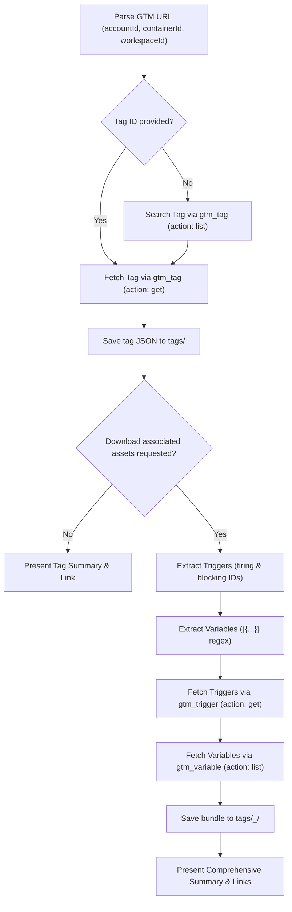

# GTM Tag Downloader

Downloads a tag's current JSON setup from Google Tag Manager using `gtm-mcp-server` and saves it to the local workspace under `tags/`.

Supports two operating modes:
1. **Standard Mode (Default)**: Downloads only the tag configuration as `tags/<tagId>_<sanitized_name>.json`.
2. **Associated Assets Mode (Optional)**: When requested (e.g. "include variables and triggers", "with dependencies"), also extracts and downloads all associated triggers and referenced variables, bundling them under `tags/<tagId>_<sanitized_name>/`.

---

## Operational Rules & Invariants

All agents executing this skill MUST strictly adhere to the following directives (detailed in [operational_rules.md](./references/operational_rules.md)):

1. **Python Tooling (`uv`)**: ALWAYS execute helper scripts and Python one-liners with `uv run` (e.g., `uv run <script>`). NEVER invoke raw `python` or `python3`.
2. **GTM Resource Extraction**: Validate that `accountId`, `containerId`, and `workspaceId` are parsed from the GTM URL before issuing tool calls.
3. **Strict Read-Only MCP Calls**: Use ONLY `get` and `list` operations on `gtm-mcp-server` (`gtm_tag`, `gtm_trigger`, `gtm_variable`). NEVER execute mutating operations (`create`, `update`, `remove`, `revert`).
4. **Rate Limit Defense**: Use `action: "list"` with pagination (`itemsPerPage: 20`) for batch variable lookups rather than issuing individual queries.
5. **Persistence & Presentation**: Save artifacts under `tags/` formatted with 2-space indented JSON, and present results using clickable `file://` links.
6. **No Secrets Logging**: Never output, save, or commit authentication tokens, private pixels, or client PII.

---

## Workflow Overview



---

## Detailed Steps

### Step 1: Parse the GTM URL

Extract `accountId`, `containerId`, `workspaceId`, and optional `tagId` using `uv run`:
```bash
uv run .agents/skills/gtm-tag-downloader/scripts/parse_gtm_url.py parse "<GTM_URL>"
```

Or extract using regex:
- **`accountId`**: `accounts/(\d+)`
- **`containerId`**: `containers/(\d+)`
- **`workspaceId`**: `workspaces/(\d+)`
- **`tagId`** (optional): `tags/(\d+)`

If any of `accountId`, `containerId`, or `workspaceId` are missing, prompt the user for clarification.

---

### Step 2: Resolve Tag ID & Fetch Tag

- **By Tag ID**: Call MCP tool `gtm_tag` on server `gtm-mcp-server` with `action: "get"`:
  ```json
  {
    "action": "get",
    "accountId": "<accountId>",
    "containerId": "<containerId>",
    "workspaceId": "<workspaceId>",
    "tagId": "<tagId>"
  }
  ```
- **By Tag Name**: Call `gtm_tag` with `action: "list"` (paginate with `itemsPerPage: 20`, `page: 1, 2, ...`). Match `name` property. If multiple match or none match, display available tags and ask for confirmation.

Save standalone tag JSON to `tags/<tagId>_<sanitized_name>.json`.

---

### Step 3: Optional Mode — Download Associated Assets (Triggers & Variables)

Activate this step **only** when the user requests it (e.g. mentions "with dependencies", "include variables", "include triggers", "download associated assets", or `--with-dependencies`).

#### 3.1 Extract References from Tag JSON
Run the reference extractor using `uv`:
```bash
uv run .agents/skills/gtm-tag-downloader/scripts/parse_gtm_url.py extract-refs --file "tags/<tagId>_<sanitized_name>.json"
```
This outputs:
- **Triggers**: List of firing and blocking trigger IDs from `firingTriggerId` and `blockingTriggerId`.
- **Variables**: Unique set of variable names found inside `{{variable_name}}` references.

#### 3.2 Fetch Associated Triggers
For each extracted trigger ID:
Call MCP tool `gtm_trigger` on `gtm-mcp-server`:
```json
{
  "action": "get",
  "accountId": "<accountId>",
  "containerId": "<containerId>",
  "workspaceId": "<workspaceId>",
  "triggerId": "<triggerId>"
}
```
*Note*: Check if the trigger itself references any additional variables (e.g., in `filter` or `customEventFilter`) and add them to the variable list.

#### 3.3 Fetch Referenced Variables
Call MCP tool `gtm_variable` on `gtm-mcp-server` with `action: "list"`:
```json
{
  "action": "list",
  "accountId": "<accountId>",
  "containerId": "<containerId>",
  "workspaceId": "<workspaceId>",
  "itemsPerPage": 20,
  "page": 1
}
```
- Paginate through variables and match each variable's `name` to the extracted list of referenced variable names.
- Collect the full variable JSON objects for all matches.
- For GTM built-in variables (e.g., `_event`, `Page URL`), note them as built-in variables (they can be queried via `gtm_built_in_variable` if needed).

> [!TIP]
> **API Rate Limits**: The GTM API enforces queries-per-minute limits. Using `action: "list"` to search variables in batches minimizes API calls and avoids HTTP 429 quota errors.

#### 3.4 Save Structured Bundle Directory
Create the bundle structure using `save-bundle` in `parse_gtm_url.py` or directly:
```text
tags/<tagId>_<sanitized_name>/
├── tag.json                        # The tag configuration
├── bundle.json                     # Complete bundle (tag + triggers + variables)
├── triggers/
│   ├── <triggerId>_<name>.json
│   └── ...
└── variables/
    ├── <variableId>_<name>.json
    └── ...
```

---

### Step 4: Deliver Results

Output a structured markdown report:
1. **Tag Details**: Name, ID, Type, Status, Firing Option.
2. **Associated Triggers**: List of triggers (ID, Name, Type) with clickable file links.
3. **Referenced Variables**: List of variables (ID, Name, Type) with clickable file links.
4. **Primary File Links**:
   - Standalone Tag: `[<tagId>_<name>.json](file:///path/to/tags/<tagId>_<name>.json)`
   - Complete Bundle: `[bundle.json](file:///path/to/tags/<tagId>_<name>/bundle.json)`
